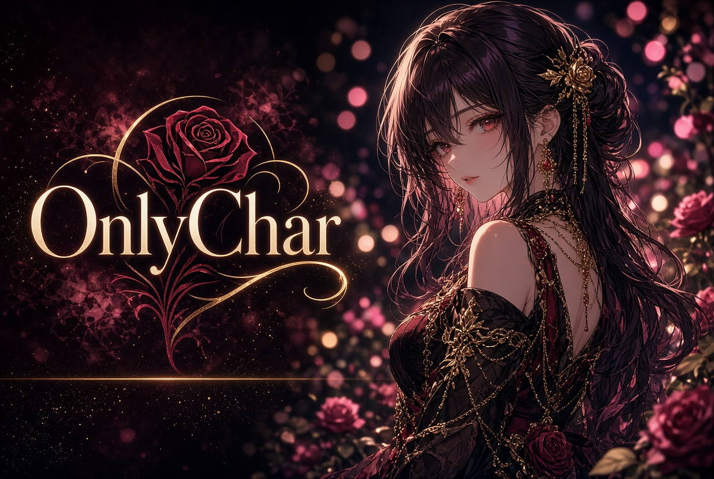
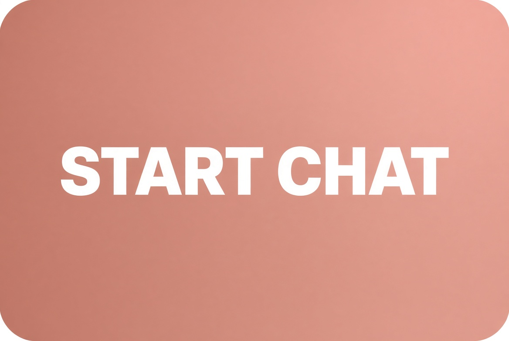

# OnlyChar AI - Chat With AI Characters

### Browse a large library of AI characters or create your own. Chat in the browser, 18+.

---

**What is OnlyChar**

OnlyChar is an 18+ AI character chat. You pick a character from a large community library or build your own, then talk in the browser. It is built around characters with a name, a look and a personality, not a blank chatbot.

The library is the main draw. You can start from someone else's character in a minute, or make one around a specific personality and opening scene. Chat stays tied to that character. Some plans add image generation. Limits and prices change, so check the live page before you pay.

It runs in the browser. No install is required to try it. You must be 18+.

[Open OnlyChar](https://chubby-gf.com/onlychar)

---

**Why OnlyChar**

**A big library.** Start from a community character instead of building everything yourself.

**Your own character.** Name, look, personality and greeting, if you want something specific.

**Chat first.** The product is a conversation with a character, in the browser.

**Images on paid plans.** Generation is listed on several plans. Confirm what your tier includes.

**Simple start.** Open the site, pick a character, send a message.

[Start a chat on OnlyChar](https://chubby-gf.com/onlychar)

---

**At a glance**

| Topic | What to know |
| --- | --- |
| Product | OnlyChar |
| Best for | Character chat from a large library |
| Library | Community characters plus your own |
| Chat | Browser, free tier with limits |
| Media | Image generation on some plans |
| Age | 18+ only |

---

**How to start**

1. [Open OnlyChar](https://chubby-gf.com/onlychar). You must be 18+.
2. Pick a character from the library or create one.
3. Send the first message and see if the tone fits.
4. Check the plan screen before you upgrade.

---

**Pricing**

There is usually a limited free tier and paid plans that raise message limits and unlock more of the library and image tools. Plan names and prices move. Open the upgrade screen and read the current numbers.

[See OnlyChar plans](https://chubby-gf.com/onlychar)

---

**Pros and cons**

**Pros**

- Large character library.
- You can create your own character.
- Chat works in the browser.
- Free tier to try before paying.

**Cons**

- Quality depends on the character you pick.
- Media and higher limits sit on paid plans.
- Adult product. Do not put sensitive personal data into the chat.
- Not a substitute for a real person or for professional help.

---

**FAQ**

**What is OnlyChar?**  
An 18+ AI character chat. You talk to community or custom characters in the browser.

**Is it free?**  
There is a limited free tier. Paid plans raise limits. Confirm the current offer at signup.

**Can I create a character?**  
Yes. Name, look, personality and greeting.

**Is this the official page?**  
No. This is an independent overview. Links go to the product.

---

OnlyChar fits if you want a large library of AI characters and a chat you can start in the browser. Check the live plan, then decide.

  

[Try OnlyChar](https://chubby-gf.com/onlychar)

